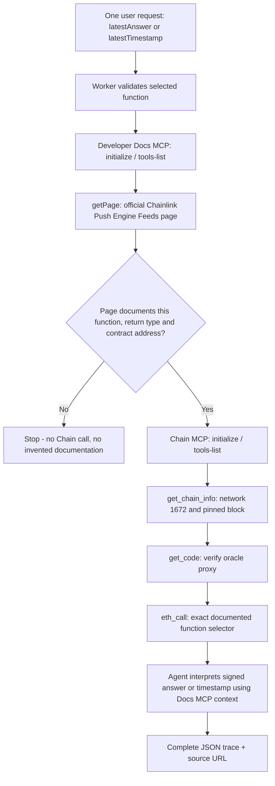

# Docs MCP + Chain MCP Agent — Pharos Agent Arena

[Public Cloudflare Worker](https://docs-mcp-chain-mcp-agent.trantanlong2411.workers.dev/) · [Source repository](https://github.com/trantanlong2411-droid/Docs-MCP-Chain-MCP-Agent)

## What this agent really does

From **one browser request**, the Worker first calls the official **Pharos Developer Docs MCP** at `https://docs.pharos.xyz/~gitbook/mcp`, retrieves the official [Chainlink Push Engine Feeds](https://docs.pharos.xyz/tooling-and-infrastructure/oracles/chainlink-pe) page with its working `getPage` tool, validates that the page documents the requested on-chain function, return ABI type and PROS/USD mainnet contract. It then starts a separate **Pharos Chain MCP** session to check the live network, verify deployed code, invoke the **same** function by `eth_call` and interpret the result using the original Docs MCP explanation.

This is a real composition: the Chain call **cannot start** before a matching source-backed Docs MCP answer has been retrieved. The function name is not just displayed in a separate panel.

### Two distinct, officially documented functions

Both are on the official Pacific Mainnet PROS/USD Chainlink self-managed price feed proxy:

Contract: `0x371Ed36aEe5bFFbED1A2aa9b7deD7F4EB30F5466` (published in the official Pharos documentation).

| Function | Return type | Agent interpretation |
| --- | --- | --- |
| `latestAnswer()` | `int256` | Reported PROS/USD feed value; official documentation specifies **18 decimals** |
| `latestTimestamp()` | `uint256` | Timestamp metadata from the feed proxy; the agent explains Unix time and feed staleness |

The function selectors are generated using ethers Keccak-256, not guessed. Each Chain call is at a pinned current Pharos Mainnet block (ID 1672). Only read-only `eth_call` is used — **no transaction is signed or broadcast**.

The official docs explain that these self-managed feeds are pushed to a cache by a Chainlink CRE workflow; the timestamp is the original observation timestamp and can be stale. The agent does **not** represent an oracle result as a guaranteed current market price, and does not encourage trades.

## End-to-end tool diagram



## Mapping to the four requirements

1. **Docs MCP sourced explanation:** `getPage` fetches the official Pharos oracle page in the same run. The source URL is recorded because that exact URL was fetched by Docs MCP. The application checks the raw response actually includes the selected Solidity function and return type; it never fabricates an answer.
2. **Chain MCP calls the same function:** selects one verified signature, encodes the exact selector, checks chain 1672 and bytecode, executes `eth_call` via hosted Chain MCP `https://mcp.pharos.xyz/mcp`.
3. **Result interpreted in context:** answers are decoded as ABI `int256` or `uint256`, using the documented 18 decimal precision or timestamp caveats.
4. **Two distinct functions:** both `latestAnswer()` and `latestTimestamp()` are documented on the same official page and executed independently on the same deployed proxy contract.

## Try the demo

1. Open the website. Select **latestAnswer()**; click **Explain → Call → Interpret**.
2. Read the Docs MCP excerpt and its documentation source URL. Check the raw on-chain value and the 18-decimal interpretation.
3. Select **latestTimestamp()**; click the same button.
4. Confirm a different function selector, different return type, and timestamp interpretation.
5. Expand the full trace. The Docs MCP `getPage` step precedes all Chain MCP calls.
6. Export JSON evidence. The repository's GitHub Actions also tests both real hosted MCP services and saves a `pharos-docs-chain-mcp-agent-live-evidence` artifact after successful live checks.

## Verified vs unverified behavior

- The external Docs MCP `askQuestion` and `searchDocumentation` tools returned `Internal Server Error` during initial probes on 3 Nov 2026; **`getPage` worked**, and is used in this implementation. This distinction is shown to reviewers rather than hiding an MCP outage.
- Public documentation content may change. If `getPage` fails or no longer contains the selected ABI and contract address, the flow fails closed before the Chain call.
- `/api/health` verifies Worker routing only; it does **not** prove external MCP service availability. The deployed integration tests perform actual MCP calls.
- The Chainlink feed data may become stale. The agent does not authorize trades or take action with real funds.
- The browser's local audit is not immutable proof; use an exported JSON or the CI artifact.

## Test and deploy

```sh
npm install
npm test
npm run build
npx wrangler deploy
```

[CI workflow](https://github.com/trantanlong2411-droid/Docs-MCP-Chain-MCP-Agent/actions/workflows/verify.yml)

## Sources

- [Official Pharos Chainlink Push Engine Feeds](https://docs.pharos.xyz/tooling-and-infrastructure/oracles/chainlink-pe)
- [Official Pharos Chain MCP](https://github.com/PharosNetwork/pharos-mcp)
- [GitBook Developer Docs MCP](https://docs.pharos.xyz/~gitbook/mcp)
- [MCP Streamable HTTP](https://modelcontextprotocol.io/specification/2025-03-26/basic/transports)
