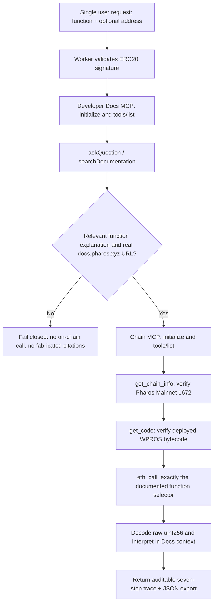

# Docs MCP + Chain MCP Agent — Pharos Agent Arena

100-point composition challenge · [Live Worker](https://docs-mcp-chain-mcp-agent.trantanlong2411.workers.dev/) · [Source repository](https://github.com/trantanlong2411-droid/Docs-MCP-Chain-MCP-Agent).

## Goal and honest scope

Build an agent that first explains a contract function by consulting **Pharos Developer Docs MCP**, including actual documentation source URLs, and then calls **that same contract function** using official Pharos **Chain MCP**. The response explains the uint256 result and records every step from one browser request. Two ERC-20 functions are supported on a deployed WPROS mainnet contract:

- `balanceOf(address)` — selector `0x70a08231`, with a public wallet address argument;
- `totalSupply()` — selector `0x18160ddd`, no arguments.

Contract: `0x52c48d4213107b20bc583832b0d951fb9ca8f0b0` (Wrapped PROS / WPROS; discovered through publicly listed mainnet token contracts). The code verifies bytecode is present through Chain MCP on every call; it will not pretend this address exists without getting code.

This app makes **read-only eth_call** calls on Pharos Mainnet chain 1672; there are no signed transactions, no token transfers and no transaction receipts. A uint256 contract return is raw smallest units. We do **not** assume the token decimals or convert it to a financial amount.

## One request, two real MCP servers



Both endpoints speak MCP Streamable HTTP:

- Developer Docs MCP `https://docs.pharos.xyz/~gitbook/mcp` — official GitBook documentation tools discovered dynamically; the service may change available tools or parameters.
- Chain MCP `https://mcp.pharos.xyz/mcp` — official hosted read-only Pharos mainnet 1672; verified `get_chain_info`, `get_code`, `eth_call`.

The code does **not** use direct RPC while pretending it is MCP. It opens two independent sessions, dynamically reads `tools/list`, calls each service and closes the session. Source URLs are taken exclusively from the actual Docs MCP reply, not embedded as hard-coded citations.

If Developer Docs MCP produces unrelated, missing or unsourced information, it refuses to call the contract. This can cause a test to fail when docs are incomplete — it is safer than inventing an explanation.

## How a reviewer verifies the four requirements

| Task requirement | Implementation |
| --- | --- |
| Explanation from Docs MCP, with cited sources | Invokes actual `askQuestion` or `searchDocumentation`, parses URLs from returned MCP content and checks whether the explanation mentions the selected function. No fake citations are injected. |
| Agent then calls same function via Chain MCP | Each validated function has exactly one ERC20 selector and ABI argument shape. `get_code` checks code, then `eth_call` uses identical selected function on the WPROS contract. Trace includes both signatures and decoded value. |
| Interprets result in context of explanation | Explanation is carried forward along with Chain MCP raw result and contract view interpretation; smallest token units are clearly identified. |
| At least 2 functions/contracts | Supports `balanceOf(address)` and `totalSupply()` (two distinct functions on one ERC-20 contract). |

### Reviewer walkthrough

1. Open the public Worker.
2. Select `balanceOf(address)` and click **Explain → Call → Interpret**.
3. Confirm at least one genuine `docs.pharos.xyz` citation and the raw on-chain ERC-20 balance. Inspect the trace; Docs runs **before** the Chain contract call.
4. Select `totalSupply()` and rerun. Confirm it queries this different function via its distinct selector.
5. Expand the full trace and verify the two function signatures match. Export the JSON proof.
6. GitHub Actions should show both independent functions completed on the deployed Worker and provide a downloadable `pharos-docs-chain-mcp-agent-live-evidence` artifact.

## Security and limits

- Mainnet read-only, no signature or blockchain state changes. Do not conflate `eth_call` with a successful mined transaction.
- Docs MCP provides **documentation**, not independent smart contract audits. The ABI encoding and short explanations are implemented in code, but claimed citations only come from the actual Docs MCP content.
- Unsupported or transfer functions cannot be called. The user cannot override the contract address or MCP URLs.
- The source docs may not include ERC-20-specific methods, or a server may be temporarily inaccessible. In those cases the API returns a fail-closed error and **does not** claim the complete task was verified.
- `/api/health` checks only the Worker, not the availability of hosted MCP.
- Browser-local history is not tamper-resistant proof; export JSON and use the independent GitHub Actions CI integration run.

## Build and tests

```bash
npm install
npm test
npm run build
npx wrangler deploy
```

GitHub Actions workflow: https://github.com/trantanlong2411-droid/Docs-MCP-Chain-MCP-Agent/actions/workflows/verify.yml

## References

- [Pharos Chain MCP official repository](https://github.com/PharosNetwork/pharos-mcp)
- [Official Pharos Developer Documentation](https://docs.pharos.xyz/)
- [MCP Streamable HTTP specification](https://modelcontextprotocol.io/specification/2025-03-26/basic/transports)
- [Agent Arena task](https://pharos-agent-arena.vercel.app/tasks/docs-mcp-chain-mcp-agent)
